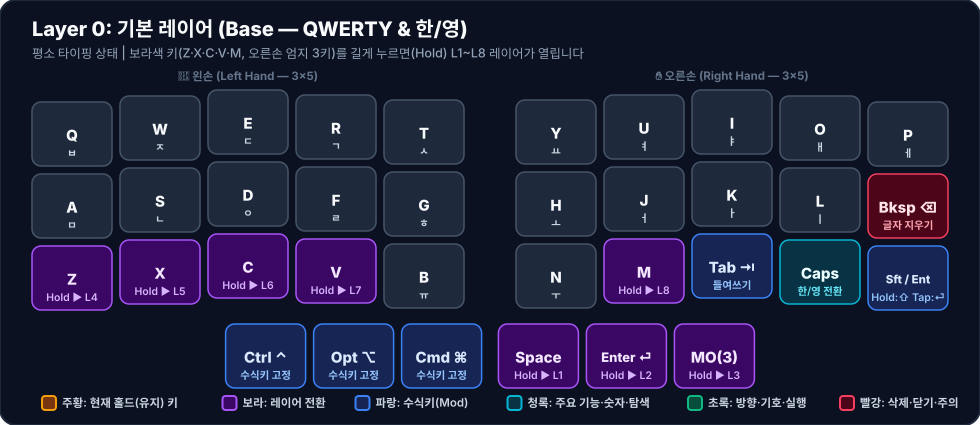

# ⌨️ Layer 0: 기본 레이어 (Base)

평소 한국어(두벌식) 및 영어(QWERTY) 타이핑을 수행하는 기본 상태의 레이어입니다. 모든 보조 레이어(`Layer 1` ~ `Layer 8`)로 진입하는 8개의 트리거 키가 이 레이어에 배치되어 있습니다.

---

## 1. 시각적 키맵 다이어그램 (Visual Keymap)

### 🤚 왼손 키 배치표 (Left Hand — 1칸 = 1키)

|    행 \ 손가락     |            새끼 (`Col 0`)             |            약지 (`Col 1`)             |             중지 (`Col 2`)              |             검지 (`Col 3`)             |           안쪽 검지 (`Col 4`)            |
| :------------: | :---------------------------------: | :---------------------------------: | :-----------------------------------: | :----------------------------------: | :----------------------------------: |
| **상단 (`Q~T`)** |     **Q** <small>`ㅂ`</small>     |     **W** <small>`ㅈ`</small>     |      **E** <small>`ㄷ`</small>      |     **R** <small>`ㄱ`</small>      |     **T** <small>`ㅅ`</small>      |
| **중단 (`A~G`)** |     **A** <small>`ㅁ`</small>     |     **S** <small>`ㄴ`</small>     |      **D** <small>`ㅇ`</small>      |     **F** <small>`ㄹ`</small>      |     **G** <small>`ㅎ`</small>      |
| **하단 (`Z~B`)** | **Z** <small>`Hold ▶ L4`</small> | **X** <small>`Hold ▶ L5`</small> |  **C** <small>`Hold ▶ L6`</small>  | **V** <small>`Hold ▶ L7`</small>  | **B** <small>`Hold ▶ L8`</small> |
|  **엄지 (3키)**   |               *(없음)*                |               *(없음)*                | **Ctrl ⌃** <small>`수식키 고정`</small> | **Opt ⌥** <small>`수식키 고정`</small> | **Cmd ⌘** <small>`수식키 고정`</small> |

### ✋ 오른손 키 배치표 (Right Hand — 1칸 = 1키)

| 행 \ 손가락 | 안쪽 검지 (`Col 4`) | 검지 (`Col 3`) | 중지 (`Col 2`) | 약지 (`Col 1`) | 새끼 (`Col 0`) |
| :---: | :---: | :---: | :---: | :---: | :---: |
| **상단 (`Y~P`)** | **Y** <small>`ㅛ`</small> | **U** <small>`ㅕ`</small> | **I** <small>`ㅑ`</small> | **O** <small>`ㅐ`</small> | **P** <small>`ㅔ`</small> |
| **중단 (`H~⌫`)** | **H** <small>`ㅗ`</small> | **J** <small>`ㅓ`</small> | **K** <small>`ㅏ`</small> | **L** <small>`ㅣ`</small> | **Bksp ⌫** <small>`글자 지우기`</small> |
| **하단 (`N~⏎`)** | **N** <small>`ㅜ`</small> | **M** <small>`ㅡ`</small> | **Tab ⇥** <small>`들여쓰기`</small> | **Caps** <small>`한/영 전환`</small> | **Sft / Ent** <small>`Hold:⇧ Tap:⏎`</small> |
| **엄지 (3키)** | **Space** <small>`Hold ▶ L1`</small> | **Enter ⏎** <small>`Hold ▶ L2`</small> | **MO(3)** <small>`Hold ▶ L3`</small> | *(없음)* | *(없음)* |

---

## 2. 특수 키 및 설계 의도

1. **오른손 중단 끝 `Bksp(⌫)` (Index `25`)**
   - 일반 키보드의 `;` 자리에 `Backspace`를 배치하여 새끼손가락을 멀리 뻗지 않고 홈 로우에서 즉시 오타를 지울 수 있습니다. (`;`와 `:`는 각각 [[layer-1-nav-num-sym|Layer 1]]과 [[layer-2-shift-sym|Layer 2]]의 `H` 자리에 배치)
2. **오른손 하단 특수 3키 (`Tab`, `Caps`, `Sft/Ent`)**
   - 36키 배열에서 부족하기 쉬운 필수 제어 키를 오른손 하단 `, . /` 자리(Index `32, 31, 30`)에 배치했습니다. (`, . /` 기호는 [[layer-1-nav-num-sym|Layer 1]]의 동일 위치에 배치)
   - `Caps` (`KC_CAPS`, Index `31`): macOS 기본 한/영 전환 키로 동작합니다.
   - `Sft/Ent` (`KC_SFTENT`, Index `30`): 짧게 치면 `Enter`, 누르고 있으면 `Left Shift`로 동작하여 양손 대문자 입력과 엔터를 겸합니다.
3. **8개 레이어 진입 트리거 요약**
   - 오른손 엄지 3키: `LT(1, KC_SPC)` ([[layer-1-nav-num-sym|L1]]), `LT(2, KC_ENT)` ([[layer-2-shift-sym|L2]]), `MO(3)` ([[layer-3-mouse-media|L3]])
   - 왼손 하단 5키 (L4~L8 일렬 정렬): `LT(4, KC_Z)` ([[layer-4-browser-edit|L4]]), `LT(5, KC_X)` ([[layer-5-ide-coding|L5]]), `LT(6, KC_C)` ([[layer-6-hyper-meh|L6]]), `LT(7, KC_V)` ([[layer-7-numpad|L7]]), `LT(8, KC_B)` ([[layer-8-macos-system|L8]])
