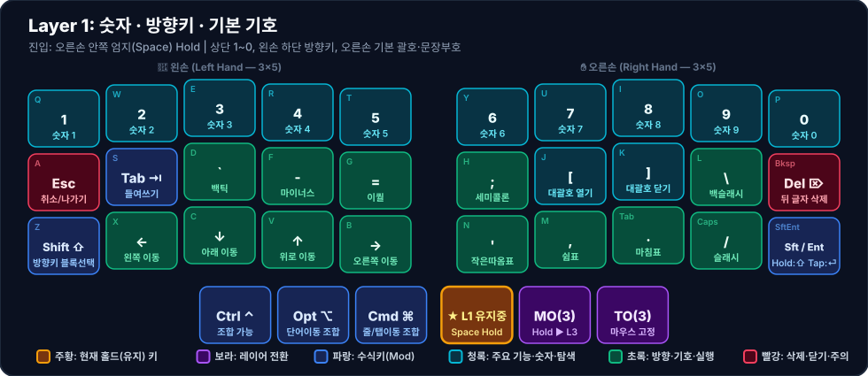

# 🔢 Layer 1: 숫자 · 방향키 · 기본 기호

**진입 방법**: 오른손 안쪽 엄지(`Space`, Index `39`) 홀드

가장 사용 빈도가 높은 핵심 보조 레이어로, **상단 숫자열(`1~0`)**, **왼손 방향키(`←↓↑→`)**, **오른손 기본 문장·코딩 기호(`[];'\,./`)**를 담당합니다. [[layer-2-shift-sym|Layer 2]]와 완벽한 1:1 대칭 구조를 이룹니다.

---

## 1. 시각적 키맵 다이어그램 (Visual Keymap)

### 🤚 왼손 키 배치표 (Left Hand — 1칸 = 1키)

| 행 \ 손가락 | 새끼 (`Col 0`) | 약지 (`Col 1`) | 중지 (`Col 2`) | 검지 (`Col 3`) | 안쪽 검지 (`Col 4`) |
| :---: | :---: | :---: | :---: | :---: | :---: |
| **상단 (`Q~T`)** | **1** <small>`숫자 1`</small> | **2** <small>`숫자 2`</small> | **3** <small>`숫자 3`</small> | **4** <small>`숫자 4`</small> | **5** <small>`숫자 5`</small> |
| **중단 (`A~G`)** | **Esc** <small>`취소/나가기`</small> | **Tab ⇥** <small>`들여쓰기`</small> | **`** <small>`백틱`</small> | **-** <small>`마이너스`</small> | **=** <small>`이퀄`</small> |
| **하단 (`Z~B`)** | **Shift ⇧** <small>`방향키 블록선택`</small> | **←** <small>`왼쪽 이동`</small> | **↓** <small>`아래 이동`</small> | **↑** <small>`위로 이동`</small> | **→** <small>`오른쪽 이동`</small> |
| **엄지 (3키)** | *(없음)* | *(없음)* | **Ctrl ⌃** <small>`조합 가능`</small> | **Opt ⌥** <small>`단어이동 조합`</small> | **Cmd ⌘** <small>`줄/탭이동 조합`</small> |

### ✋ 오른손 키 배치표 (Right Hand — 1칸 = 1키)

| 행 \ 손가락 | 안쪽 검지 (`Col 4`) | 검지 (`Col 3`) | 중지 (`Col 2`) | 약지 (`Col 1`) | 새끼 (`Col 0`) |
| :---: | :---: | :---: | :---: | :---: | :---: |
| **상단 (`Y~P`)** | **6** <small>`숫자 6`</small> | **7** <small>`숫자 7`</small> | **8** <small>`숫자 8`</small> | **9** <small>`숫자 9`</small> | **0** <small>`숫자 0`</small> |
| **중단 (`H~⌫`)** | **;** <small>`세미콜론`</small> | **[** <small>`대괄호 열기`</small> | **]** <small>`대괄호 닫기`</small> | **\** <small>`백슬래시`</small> | **Del ⌦** <small>`뒤 글자 삭제`</small> |
| **하단 (`N~⏎`)** | **'** <small>`작은따옴표`</small> | **,** <small>`쉼표`</small> | **.** <small>`마침표`</small> | **/** <small>`슬래시`</small> | **Sft / Ent** <small>`Hold:⇧ Tap:⏎`</small> |
| **엄지 (3키)** | 🟧 **★ L1 유지중** <small>Space Hold</small> | **MO(3)** <small>`Hold ▶ L3`</small> | **TO(3)** <small>`마우스 고정`</small> | *(없음)* | *(없음)* |

---

## 2. 설계 포인트 및 주요 조합

1. **오른손 홈 로우 괄호 (`[` / `]`)**
   - 오른손 검지(`J` 자리, Index `28`)와 중지(`K` 자리, Index `27`)에 `[`와 `]`를 배치하여 코딩 및 마크다운 링크(`[[위키링크]]`) 작성 시 손목 이동 없이 즉시 입력합니다.
2. **왼손 하단 Vim 스타일 방향키 (`← ↓ ↑ →`) + `Shift`**
   - 왼손 하단 첫 키(`Z` 자리, Index `10`)에 `KC_LSFT`를 배치하고 그 옆(`X, C, V, B` 자리)에 `← ↓ ↑ →`를 두어, 왼손 새끼로 `Shift`를 누른 채 방향키로 텍스트 블록을 선택하거나 왼손 엄지 `Cmd`/`Opt`와 조합해 단어·줄 단위 이동/선택(`Opt+Shift+←/→`, `Cmd+Shift+←/→`)을 수행할 수 있습니다.
3. **Forward Delete (`Del ⌦`)**
   - [[layer-0-base|Layer 0]]의 `Backspace`(오른손 중단 끝, Index `25`) 자리에서 Layer 1을 열면 커서 뒤쪽 글자를 지우는 `KC_DEL`이 됩니다.
4. **Layer 3 브릿지 (`MO(3)` / `TO(3)`)**
   - Layer 1을 누른 상태에서 오른손 중간 엄지(Index `38`)를 함께 누르면 [[layer-3-mouse-media|Layer 3]]이 일시 활성화되고, 바깥 엄지(Index `37`)를 누르면 `TO(3)`으로 마우스 레이어가 고정됩니다.
