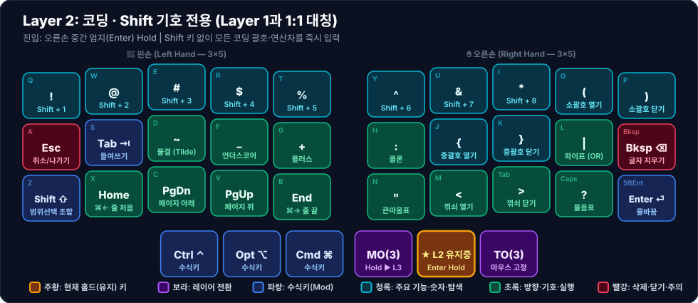

# 💻 Layer 2: 코딩 · Shift 기호 전용

**진입 방법**: 오른손 중간 엄지(`Enter`, Index `38`) 홀드

[[layer-1-nav-num-sym|Layer 1]]의 모든 숫자와 기본 기호 자리에 **Shift가 적용된 짝꿍 기호**를 1:1로 매핑한 레이어입니다. Shift 키를 별도로 조합할 필요 없이 엄지 하나로 모든 코딩 기호(`!@#$%^&*()`, `{}`, `~_+`, `:"<>?|`)를 입력합니다.

---

## 1. 시각적 키맵 다이어그램 (Visual Keymap)

### 🤚 왼손 키 배치표 (Left Hand — 1칸 = 1키)

| 행 \ 손가락 | 새끼 (`Col 0`) | 약지 (`Col 1`) | 중지 (`Col 2`) | 검지 (`Col 3`) | 안쪽 검지 (`Col 4`) |
| :---: | :---: | :---: | :---: | :---: | :---: |
| **상단 (`Q~T`)** | **!** <small>`Shift + 1`</small> | **@** <small>`Shift + 2`</small> | **#** <small>`Shift + 3`</small> | **$** <small>`Shift + 4`</small> | **%** <small>`Shift + 5`</small> |
| **중단 (`A~G`)** | **Esc** <small>`취소/나가기`</small> | **Tab ⇥** <small>`들여쓰기`</small> | **~** <small>`물결 (Tilde)`</small> | **_** <small>`언더스코어`</small> | **+** <small>`플러스`</small> |
| **하단 (`Z~B`)** | **Shift ⇧** <small>`범위선택 조합`</small> | **Home** <small>`⌘← 줄 처음`</small> | **PgDn** <small>`페이지 아래`</small> | **PgUp** <small>`페이지 위`</small> | **End** <small>`⌘→ 줄 끝`</small> |
| **엄지 (3키)** | *(없음)* | *(없음)* | **Ctrl ⌃** <small>`수식키`</small> | **Opt ⌥** <small>`수식키`</small> | **Cmd ⌘** <small>`수식키`</small> |

### ✋ 오른손 키 배치표 (Right Hand — 1칸 = 1키)

| 행 \ 손가락 | 안쪽 검지 (`Col 4`) | 검지 (`Col 3`) | 중지 (`Col 2`) | 약지 (`Col 1`) | 새끼 (`Col 0`) |
| :---: | :---: | :---: | :---: | :---: | :---: |
| **상단 (`Y~P`)** | **^** <small>`Shift + 6`</small> | **&** <small>`Shift + 7`</small> | ***** <small>`Shift + 8`</small> | **(** <small>`소괄호 열기`</small> | **)** <small>`소괄호 닫기`</small> |
| **중단 (`H~⌫`)** | **:** <small>`콜론`</small> | **{** <small>`중괄호 열기`</small> | **}** <small>`중괄호 닫기`</small> | **\|** <small>`파이프 (OR)`</small> | **Bksp ⌫** <small>`글자 지우기`</small> |
| **하단 (`N~⏎`)** | **"** <small>`큰따옴표`</small> | **<** <small>`꺾쇠 열기`</small> | **>** <small>`꺾쇠 닫기`</small> | **?** <small>`물음표`</small> | **Enter ⏎** <small>`줄바꿈`</small> |
| **엄지 (3키)** | **MO(3)** <small>`Hold ▶ L3`</small> | 🟧 **★ L2 유지중** <small>Enter Hold</small> | **TO(3)** <small>`마우스 고정`</small> | *(없음)* | *(없음)* |

---

## 2. Layer 1 ↔ Layer 2 1:1 대칭 매핑표

| 위치 | Layer 1 (`Spc` 홀드) | Layer 2 (`Ent` 홀드) | 코딩 활용 예시 |
| :--- | :---: | :---: | :--- |
| **상단 1~10열** | `1 2 3 4 5` / `6 7 8 9 0` | `! @ # $ %` / `^ & * ( )` | 함수 호출 `()` (오른손 약지·새끼 상단) |
| **왼손 중단 3~5열** | `` ` - = `` | `~ _ +` | 스네이크 케이스 `_`, 대입/증감 `= / +` |
| **오른손 중단 6~9열** | `; [ ] \` | `: { } \|` | 코드 블록 `{}` (오른손 검지·중지 홈 로우) |
| **오른손 하단 6~9열** | `' , . /` | `" < > ?` | 문자열 `'` / `"`, 제네릭·화살표 `< >` |
| **왼손 하단 2~5열** | `← ↓ ↑ →` | `⌘← PgDn PgUp ⌘→` | 방향키 자리 그대로 줄 처음/끝·페이지 이동 |

> [!TIP]
> 상세한 코딩 단축키 연쇄 활용법은 [[coding-and-ide|코딩 및 IDE 워크플로우]] 문서를 참고하세요.
