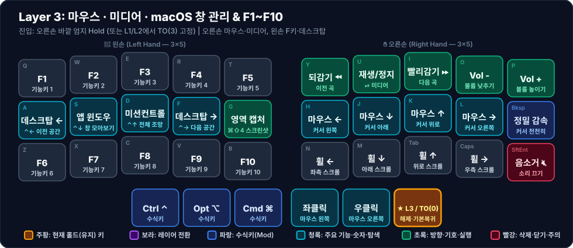

# 🖱️ Layer 3: 마우스 · 미디어 · macOS 창 관리 & F키

**진입 방법**:
- **일시 진입(Hold)**: 오른손 바깥 엄지(`MO(3)`, Index `37`) 홀드, 또는 [[layer-1-nav-num-sym|Layer 1]] + [[layer-2-shift-sym|Layer 2]] 엄지 동시 홀드
- **고정 진입(Lock)**: Layer 1 또는 Layer 2 상태에서 오른손 바깥 엄지(`TO(3)`, Index `37`) 탭 → 해제 시 다시 바깥 엄지(`TO(0)`) 탭

키보드에서 손을 떼지 않고 마우스 커서 이동·클릭·스크롤을 처리하고, 미디어 재생 및 `F1~F10`, macOS 데스크탑(Spaces) 전환을 수행합니다.

---

## 1. 시각적 키맵 다이어그램 (Visual Keymap)

### 🤚 왼손 키 배치표 (Left Hand — 1칸 = 1키)

| 행 \ 손가락 | 새끼 (`Col 0`) | 약지 (`Col 1`) | 중지 (`Col 2`) | 검지 (`Col 3`) | 안쪽 검지 (`Col 4`) |
| :---: | :---: | :---: | :---: | :---: | :---: |
| **상단 (`Q~T`)** | **F1** <small>`기능키 1`</small> | **F2** <small>`기능키 2`</small> | **F3** <small>`기능키 3`</small> | **F4** <small>`기능키 4`</small> | **F5** <small>`기능키 5`</small> |
| **중단 (`A~G`)** | **데스크탑 ←** <small>`⌃← 이전 공간`</small> | **앱 윈도우** <small>`⌃↓ 창 모아보기`</small> | **미션컨트롤** <small>`⌃↑ 전체 조망`</small> | **데스크탑 →** <small>`⌃→ 다음 공간`</small> | **영역 캡처** <small>`⌘⇧4 스크린샷`</small> |
| **하단 (`Z~B`)** | **F6** <small>`기능키 6`</small> | **F7** <small>`기능키 7`</small> | **F8** <small>`기능키 8`</small> | **F9** <small>`기능키 9`</small> | **F10** <small>`기능키 10`</small> |
| **엄지 (3키)** | *(없음)* | *(없음)* | **Ctrl ⌃** <small>`수식키`</small> | **Opt ⌥** <small>`수식키`</small> | **Cmd ⌘** <small>`수식키`</small> |

### ✋ 오른손 키 배치표 (Right Hand — 1칸 = 1키)

| 행 \ 손가락 | 안쪽 검지 (`Col 4`) | 검지 (`Col 3`) | 중지 (`Col 2`) | 약지 (`Col 1`) | 새끼 (`Col 0`) |
| :---: | :---: | :---: | :---: | :---: | :---: |
| **상단 (`Y~P`)** | **되감기 ⏪** <small>`이전 곡`</small> | **재생/정지** <small>`⏯ 미디어`</small> | **빨리감기 ⏩** <small>`다음 곡`</small> | **Vol -** <small>`볼륨 낮추기`</small> | **Vol +** <small>`볼륨 높이기`</small> |
| **중단 (`H~⌫`)** | **마우스 ←** <small>`커서 왼쪽`</small> | **마우스 ↓** <small>`커서 아래`</small> | **마우스 ↑** <small>`커서 위로`</small> | **마우스 →** <small>`커서 오른쪽`</small> | **정밀 감속** <small>`커서 천천히`</small> |
| **하단 (`N~⏎`)** | **휠 ←** <small>`좌측 스크롤`</small> | **휠 ↓** <small>`아래 스크롤`</small> | **휠 ↑** <small>`위로 스크롤`</small> | **휠 →** <small>`우측 스크롤`</small> | **음소거 🔇** <small>`소리 끄기`</small> |
| **엄지 (3키)** | **좌클릭** <small>`마우스 왼쪽`</small> | **우클릭** <small>`마우스 오른쪽`</small> | 🟧 **★ L3 / TO(0)** <small>해제·기본복귀</small> | *(없음)* | *(없음)* |

---

## 2. 왜 `MO(3)`(일시)와 `TO(3)`(고정) 두 가지 진입 방식이 있나요?

| 구분 | **`MO(3)` — Momentary (일시 홀드)** | **`TO(3)` — Turn On (레이어 고정/잠금)** |
| :--- | :--- | :--- |
| **비유** | `Shift` 키 (누르는 동안만 작동) | `Caps Lock` 키 (한 번 누르면 계속 유지) |
| **동작 방식** | 키를 **누르고 있는 동안만** Layer 3이 켜지고, **손을 떼면 즉시 복귀** | 한 번 **톡 누르고 손을 떼도 계속 Layer 3(마우스 모드)으로 고정**됨 |
| **해제 방법** | 손가락을 떼면 자동 해제 | 오른손 바깥 엄지(**`TO(0)`**)를 한 번 누르면 기본 레이어로 복귀 |
| **주 용도** | 볼륨 조절, `F1~F10` 단타, 미션컨트롤/데스크탑 1회 전환 | **본격적인 마우스 조작 (커서 이동 + 좌/우 클릭 연타 + 휠 스크롤)** |

> [!IMPORTANT]
> **마우스 조작 시 `TO(3)` 고정이 필수인 이유**:
> Layer 3에서 마우스 **좌클릭·우클릭이 오른손 엄지(`Space`, `Enter` 자리)**에 배정되어 있습니다. 만약 엄지로 레이어 키를 계속 누르고(`MO(3)`) 있으면 같은 오른손 엄지로 좌클릭/우클릭을 누르기가 힘듭니다.
> 따라서 마우스를 쓸 때는 `Space(L1)` + 바깥 엄지(`TO(3)`)를 딸깍 눌러 **마우스 모드를 고정해 두고, 오른손 엄지를 자유롭게 쓰며 좌/우 클릭**을 한 뒤 마지막에 바깥 엄지(`TO(0)`)로 빠져나오면 훨씬 편합니다.

---

## 3. 주요 설계 특징

1. **오른손 홈 로우 마우스 & 엄지 클릭**
   - 오른손 `H, J, K, L` 자리(Index `29, 28, 27, 26`)에 마우스 커서 `← ↓ ↑ →`를 배치하고, 오른손 엄지 안쪽·중간 키(Index `39, 38`)에 `좌클릭`/`우클릭`을 두어 오른손만으로 마우스 조작이 완결됩니다.
   - 정밀 클릭이 필요할 때는 오른손 새끼손가락(`Bksp` 자리, Index `25`)의 `KC_MS_ACCEL0`을 누른 채 이동하면 커서 속도가 감속됩니다.
2. **왼손 중단 macOS Spaces / Mission Control**
   - 왼손 홈 로우(`A, S, D, F` 자리)에 `Ctrl + ←/↓/↑/→`를 배치하여 전체화면 앱이나 데스크탑 공간(Spaces) 사이를 즉시 오갈 수 있습니다.
