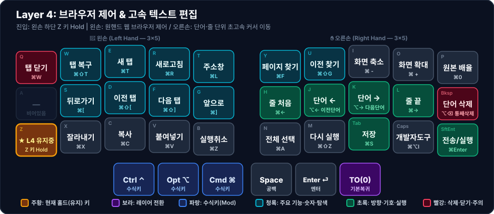

# 🌐 Layer 4: 브라우저 & 고속 텍스트 편집

**진입 방법**: 왼손 하단 첫 키 `Z` (`LT(4, KC_Z)`, Index `10`) 홀드

웹 브라우징(Chrome, Safari, Arc 등) 중 탭/히스토리 제어와 문서 작성 시 **단어·줄 단위 고속 커서 이동 및 편집**을 결합한 레이어입니다. (연관 워크플로우: [[browsing-and-text-editing|브라우징 및 고속 편집 워크플로우]])

---

## 1. 시각적 키맵 다이어그램 (Visual Keymap)

### 🤚 왼손 키 배치표 (Left Hand — 1칸 = 1키)

| 행 \ 손가락 | 새끼 (`Col 0`) | 약지 (`Col 1`) | 중지 (`Col 2`) | 검지 (`Col 3`) | 안쪽 검지 (`Col 4`) |
| :---: | :---: | :---: | :---: | :---: | :---: |
| **상단 (`Q~T`)** | **탭 닫기** <small>`⌘W`</small> | **탭 복구** <small>`⌘⇧T`</small> | **새 탭** <small>`⌘T`</small> | **새로고침** <small>`⌘R`</small> | **주소창** <small>`⌘L`</small> |
| **중단 (`A~G`)** | <small>*(비어있음)*</small> | **뒤로가기** <small>`⌘[`</small> | **이전 탭** <small>`⌘⇧[`</small> | **다음 탭** <small>`⌘⇧]`</small> | **앞으로** <small>`⌘]`</small> |
| **하단 (`Z~B`)** | 🟧 **★ L4 유지중** <small>Z 키 Hold</small> | **잘라내기** <small>`⌘X`</small> | **복사** <small>`⌘C`</small> | **붙여넣기** <small>`⌘V`</small> | **실행취소** <small>`⌘Z`</small> |
| **엄지 (3키)** | *(없음)* | *(없음)* | **Ctrl ⌃** <small>`수식키`</small> | **Opt ⌥** <small>`수식키`</small> | **Cmd ⌘** <small>`수식키`</small> |

### ✋ 오른손 키 배치표 (Right Hand — 1칸 = 1키)

| 행 \ 손가락 | 안쪽 검지 (`Col 4`) | 검지 (`Col 3`) | 중지 (`Col 2`) | 약지 (`Col 1`) | 새끼 (`Col 0`) |
| :---: | :---: | :---: | :---: | :---: | :---: |
| **상단 (`Y~P`)** | **페이지 찾기** <small>`⌘F`</small> | **이전 찾기** <small>`⌘⇧G`</small> | **화면 축소** <small>`⌘ -`</small> | **화면 확대** <small>`⌘ +`</small> | **원본 배율** <small>`⌘0`</small> |
| **중단 (`H~⌫`)** | **줄 처음** <small>`⌘←`</small> | **단어 ←** <small>`⌥← 이전단어`</small> | **단어 →** <small>`⌥→ 다음단어`</small> | **줄 끝** <small>`⌘→`</small> | **단어 삭제** <small>`⌥⌫ 통째삭제`</small> |
| **하단 (`N~⏎`)** | **전체 선택** <small>`⌘A`</small> | **다시 실행** <small>`⌘⇧Z`</small> | **저장** <small>`⌘S`</small> | **개발자도구** <small>`⌘⌥I`</small> | **전송/실행** <small>`⌘Enter`</small> |
| **엄지 (3키)** | **Space** <small>`공백`</small> | **Enter ⏎** <small>`엔터`</small> | **TO(0)** <small>`기본복귀`</small> | *(없음)* | *(없음)* |

---

## 2. 주요 설계 특징

1. **오른손 홈 로우 고속 커서 이동 (`⌘←`, `⌥←`, `⌥→`, `⌘→`, `⌥⌫`)**
   - 한 글자씩 움직이는 일반 방향키([[layer-1-nav-num-sym|Layer 1]])와 달리, Layer 4의 오른손 중단(`H, J, K, L, Bksp` 자리)은 **줄 처음(`⌘←`), 이전 단어(`⌥←`), 다음 단어(`⌥→`), 줄 끝(`⌘→`), 이전 단어 통째로 삭제(`⌥⌫`)**를 원터치로 수행합니다.
2. **왼손 상·중단 브라우저 내비게이션**
   - 상단 열(`Q~T`): 탭 닫기(`⌘W`), 닫은 탭 복구(`⌘⇧T`), 새 탭(`⌘T`), 새로고침(`⌘R`), 주소창 포커스(`⌘L`)
   - 중단 열(`S~G`): 뒤로 가기(`⌘[`), 이전 탭(`⌘⇧[`), 다음 탭(`⌘⇧]`), 앞으로 가기(`⌘]`)
   - 왼손 `A` 자리(Index `5`)는 현재 `KC_TRNS`로 비어 있어 향후 추가 브라우저 단축키(예: 북마크 바 토글 `⌘⇧B` 또는 사이드바 `⌘S`) 배정 후보입니다.
