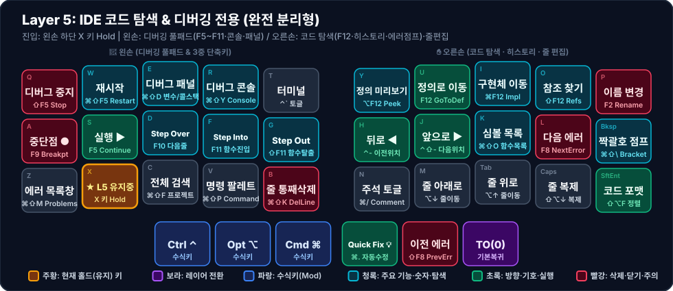

# 🛠️ Layer 5: IDE 코드 탐색 & 디버깅 전용 (완전 분리형)

**진입 방법**: 왼손 하단 두 번째 키 `X` (`LT(5, KC_X)`, Index `11`) 홀드

[[layer-0-base|Layer 0]]에서 `왼손 엄지 Cmd + 알파벳`으로 쉽게 누를 수 있는 단순 단축키(`⌘P`, `⌘B`, `⌘D`, `⌘C/V/Z`, `⌘Q/W`)를 모두 제거하고, 36키 키보드에서 직접 누르기 힘든 **F키 조합(`F2`, `F5~F12`)**과 **3중 수식키(`⌘⇧`, `⌃⇧`, `⌥⇧`)**, **기호 조합(`⌃-`, `⌘.`, `⌘⇧\`)**만 양손에 완전 분리 배치한 레이어입니다. (연관 워크플로우: [[coding-and-ide|코딩 및 IDE 워크플로우]])

---

## 1. 시각적 키맵 다이어그램 (Visual Keymap)

### 🤚 왼손 키 배치표 (디버깅 풀패드 & 패널 제어 — 1칸 = 1키)

| 행 \ 손가락 | 새끼 (`Col 0`) | 약지 (`Col 1`) | 중지 (`Col 2`) | 검지 (`Col 3`) | 안쪽 검지 (`Col 4`) |
| :---: | :---: | :---: | :---: | :---: | :---: |
| **상단 (`Q~T`)** | **디버그 중지** <small>`⇧F5 Stop`</small> | **재시작** <small>`⌘⇧F5 Restart`</small> | **디버그 패널** <small>`⌘⇧D 변수/콜스택`</small> | **디버그 콘솔** <small>`⌘⇧Y Console`</small> | **터미널** <small>`` ⌃` 토글 ``</small> |
| **중단 (`A~G`)** | **중단점 ●** <small>`F9 Breakpt`</small> | **실행 ▶** <small>`F5 Continue`</small> | **Step Over** <small>`F10 다음줄`</small> | **Step Into** <small>`F11 함수진입`</small> | **Step Out** <small>`⇧F11 함수탈출`</small> |
| **하단 (`Z~B`)** | **에러 목록창** <small>`⌘⇧M Problems`</small> | 🟧 **★ L5 유지중** <small>X 키 Hold</small> | **전체 검색** <small>`⌘⇧F 프로젝트`</small> | **명령 팔레트** <small>`⌘⇧P Command`</small> | **줄 통째삭제** <small>`⌘⇧K DelLine`</small> |
| **엄지 (3키)** | *(없음)* | *(없음)* | **Ctrl ⌃** <small>`수식키`</small> | **Opt ⌥** <small>`수식키`</small> | **Cmd ⌘** <small>`수식키`</small> |

### ✋ 오른손 키 배치표 (코드 탐색 · 히스토리 · 줄 편집 — 1칸 = 1키)

| 행 \ 손가락 | 안쪽 검지 (`Col 4`) | 검지 (`Col 3`) | 중지 (`Col 2`) | 약지 (`Col 1`) | 새끼 (`Col 0`) |
| :---: | :---: | :---: | :---: | :---: | :---: |
| **상단 (`Y~P`)** | **정의 미리보기** <small>`⌥F12 Peek`</small> | **정의로 이동** <small>`F12 GoToDef`</small> | **구현체 이동** <small>`⌘F12 Impl`</small> | **참조 찾기** <small>`⇧F12 Refs`</small> | **이름 변경** <small>`F2 Rename`</small> |
| **중단 (`H~⌫`)** | **뒤로 ◀** <small>`⌃- 이전위치`</small> | **앞으로 ▶** <small>`⌃⇧- 다음위치`</small> | **심볼 목록** <small>`⌘⇧O 함수목록`</small> | **다음 에러** <small>`F8 NextError`</small> | **짝괄호 점프** <small>`⌘⇧\ Bracket`</small> |
| **하단 (`N~⏎`)** | **주석 토글** <small>`⌘/ Comment`</small> | **줄 아래로** <small>`⌥↓ 줄이동`</small> | **줄 위로** <small>`⌥↑ 줄이동`</small> | **줄 복제** <small>`⇧⌥↓ 복제`</small> | **코드 포맷** <small>`⇧⌥F 정렬`</small> |
| **엄지 (3키)** | **Quick Fix 💡** <small>`⌘. 자동수정`</small> | **이전 에러** <small>`⇧F8 PrevErr`</small> | **TO(0)** <small>`기본복귀`</small> | *(없음)* | *(없음)* |

---

## 2. 핵심 설계 포인트

### ① 오른손 = 코드 탐색 & 추적 데크 (Code Navigation)
1. **상단 열 (`Y, U, I, O, P`) — `F12` 심볼 추적 5종 풀세트**
   - `Y`(`⌥F12`): 파일 이동 없이 팝업 창으로 정의 미리보기 (**Peek Definition**)
   - `U`(`F12`): 가장 힘 있는 검지로 정의 위치로 즉시 점프 (**Go to Definition**)
   - `I`(`⌘F12`): 인터페이스/추상 타입에서 실제 구현체로 점프 (**Go to Implementation**)
   - `O`(`⇧F12`): 이 함수/변수를 호출하는 모든 참조 위치 목록 보기 (**Find References**)
   - `P`(`F2`): 심볼 이름 일괄 리팩토링 (**Rename Symbol**)
2. **중단 홈 로우 (`H, J, K, L, Bksp`) — 커서 히스토리 & 구조 탐색**
   - `H`(`⌃-`) / `J`(`⌃⇧-`): `F12`로 깊숙이 들어갔다가 원래 보던 코드 위치로 **뒤로/앞으로 순간이동**
   - `K`(`⌘⇧O`): 현재 파일의 클래스·함수·변수 목록 검색 (**Go to Symbol in File**)
   - `L`(`F8`) & 오른손 중간 엄지(`⇧F8`): 파일 내 **다음 에러/경고(`F8`) · 이전 에러/경고(`⇧F8`)**로 즉시 점프
   - `Bksp`(`⌘⇧\`): 여는 중괄호 `{`와 닫는 중괄호 `}` 짝꿍 사이를 단숨에 점프 (**Jump to Matching Bracket**)
3. **오른손 안쪽 엄지 (`Space`) — Quick Fix (`⌘.`)**
   - 빨간 줄 위에서 `X + Space`만 누르면 **자동 Import 추가 / 타입 수정(전구 아이콘)** 메뉴가 즉시 열립니다.

### ② 왼손 = 디버깅 풀패드 (Debugging Full Deck)
왼손 약지로 `X`를 누른 상태에서 가장 움직이기 편한 **중지·검지 홈 로우(`D, F, G`)**에 스텝 실행 3종을 배치했습니다:
- **중단 (`A, S, D, F, G`)**: `중단점 토글(F9)` → `실행/계속(F5)` → **`Step Over(F10)`** → **`Step Into(F11)`** → **`Step Out(⇧F11)`**이 왼쪽에서 오른쪽으로 흐름에 맞게 이어집니다.
- **상단 (`Q, W, E, R, T`)**: 디버그 세션의 시작·끝과 뷰어를 담당합니다 (`⇧F5` 중지, `⌘⇧F5` 재시작, `⌘⇧D` 디버그 변수/콜스택 창, `⌘⇧Y` 디버그 콘솔, `` ⌃` `` 터미널).
- **하단 (`Z, [X], C, V, B`)**: 프로젝트 전체 에러 목록(`⌘⇧M`), 전체 검색(`⌘⇧F`), 명령 팔레트(`⌘⇧P`), 줄 통째 삭제(`⌘⇧K`)를 배치했습니다.
