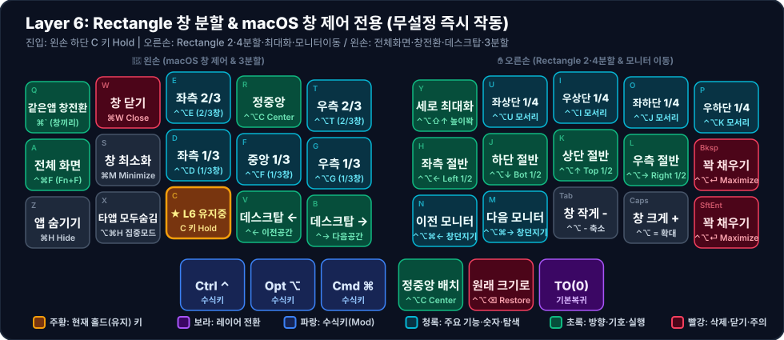

# 🪟 Layer 6: Rectangle 창 분할 & macOS 창 제어 전용 (무설정 즉시 작동)

**진입 방법**: 왼손 하단 세 번째 키 `C` (`LT(6, KC_C)`, Index `12`) 홀드

초경량 오픈소스 창 분할 앱인 **Rectangle**의 기본 단축키와 **macOS 표준 창 제어 단축키(전체 화면 `⌃⌘F`, 같은 앱 창 전환 `⌘\``, 앱 숨김 `⌘H/⌥⌘H`, 데스크탑 전환 `⌃←/→`)**를 하나로 통합한 창 관리 완성형 레이어입니다. (연관 워크플로우: [[macos-window-and-raycast|macOS 창 관리 및 시스템 제어 워크플로우]])

---

## 1. 시각적 키맵 다이어그램 (Visual Keymap)

### 🤚 왼손 키 배치표 (macOS 창 제어 & 와이드 3분할 — 1칸 = 1키)

| 행 \ 손가락 | 새끼 (`Col 0`) | 약지 (`Col 1`) | 중지 (`Col 2`) | 검지 (`Col 3`) | 안쪽 검지 (`Col 4`) |
| :---: | :---: | :---: | :---: | :---: | :---: |
| **상단 (`Q~T`)** | **같은앱 창전환** <small>`` ⌘` (창끼리) ``</small> | **창 닫기** <small>`⌘W Close`</small> | **좌측 2/3** <small>`⌃⌥E (2/3창)`</small> | **정중앙** <small>`⌃⌥C Center`</small> | **우측 2/3** <small>`⌃⌥T (2/3창)`</small> |
| **중단 (`A~G`)** | **전체 화면** <small>`⌃⌘F (Fn+F)`</small> | **창 최소화** <small>`⌘M Minimize`</small> | **좌측 1/3** <small>`⌃⌥D (1/3창)`</small> | **중앙 1/3** <small>`⌃⌥F (1/3창)`</small> | **우측 1/3** <small>`⌃⌥G (1/3창)`</small> |
| **하단 (`Z~B`)** | **앱 숨기기** <small>`⌘H Hide`</small> | **타앱 모두숨김** <small>`⌥⌘H 집중모드`</small> | 🟧 **★ L6 유지중** <small>C 키 Hold</small> | **데스크탑 ←** <small>`⌃← 이전공간`</small> | **데스크탑 →** <small>`⌃→ 다음공간`</small> |
| **엄지 (3키)** | *(없음)* | *(없음)* | **Ctrl ⌃** <small>`수식키`</small> | **Opt ⌥** <small>`수식키`</small> | **Cmd ⌘** <small>`수식키`</small> |

### ✋ 오른손 키 배치표 (Rectangle 2·4분할 & 모니터 이동 — 1칸 = 1키)

| 행 \ 손가락 | 안쪽 검지 (`Col 4`) | 검지 (`Col 3`) | 중지 (`Col 2`) | 약지 (`Col 1`) | 새끼 (`Col 0`) |
| :---: | :---: | :---: | :---: | :---: | :---: |
| **상단 (`Y~P`)** | **세로 최대화** <small>`⌃⌥⇧↑ 높이꽉`</small> | **좌상단 1/4** <small>`⌃⌥U 모서리`</small> | **우상단 1/4** <small>`⌃⌥I 모서리`</small> | **좌하단 1/4** <small>`⌃⌥J 모서리`</small> | **우하단 1/4** <small>`⌃⌥K 모서리`</small> |
| **중단 (`H~⌫`)** | **좌측 절반** <small>`⌃⌥← Left 1/2`</small> | **하단 절반** <small>`⌃⌥↓ Bot 1/2`</small> | **상단 절반** <small>`⌃⌥↑ Top 1/2`</small> | **우측 절반** <small>`⌃⌥→ Right 1/2`</small> | **꽉 채우기** <small>`⌃⌥⏎ Maximize`</small> |
| **하단 (`N~⏎`)** | **이전 모니터** <small>`⌃⌥⌘← 창던지기`</small> | **다음 모니터** <small>`⌃⌥⌘→ 창던지기`</small> | **창 작게 -** <small>`⌃⌥ - 축소`</small> | **창 크게 +** <small>`⌃⌥ = 확대`</small> | **꽉 채우기** <small>`⌃⌥⏎ Maximize`</small> |
| **엄지 (3키)** | **정중앙 배치** <small>`⌃⌥C Center`</small> | **원래 크기로** <small>`⌃⌥⌫ Restore`</small> | **TO(0)** <small>`기본복귀`</small> | *(없음)* | *(없음)* |

---

## 2. 핵심 설계 포인트

### ① 오른손 하단 `N / M` (`이전 모니터 / 다음 모니터`)의 정확한 역할
- 마우스 포커스만 옮기는 것이 아니라, **현재 보고 있는 앱 창(Window) 자체를 통째로 들어서 옆 모니터(왼쪽/오른쪽 모니터)로 이사시키는 기능**(`⌃ + ⌥ + ⌘ + ←/→`)입니다.
- **주의사항**: VIA JSON 파서 호환성을 위해 `LCAG(...)` 대신 VIA 표준 중첩 구문인 `C(LAG(KC_LEFT))` / `C(LAG(KC_RGHT))` 및 `C(A(KC_...))`로 작성되어야 정상 동작합니다.

### ② 왼손 बा깥쪽 = macOS 기본 창 & 전체 화면 제어
놀고 있던 `Hyper` 빈 슬롯을 제거하고 맥에서 매일 쓰는 창 제어 단축키 8종을 배치했습니다:
- `C + A` (`⌃⌘F`): **전체 화면 전환 (Toggle Full Screen)** — 맥북의 `🌐Fn + F`와 100% 동일하게 동작합니다.
- `C + Q` (`` ⌘` ``): **같은 앱의 다른 창으로 전환** (예: 크롬 창 2개나 VS Code 창 2개 사이만 빠르게 왔다 갔다 하기)
- `C + W` (`⌘W`): 현재 창 닫기
- `C + S` (`⌘M`): 현재 창 독(Dock)으로 최소화
- `C + Z` (`⌘H`) / `C + X` (`⌥⌘H`): 현재 앱 숨기기 / **현재 앱만 남기고 나머지 모든 앱 숨기기(집중 모드)**
- `C + V` (`⌃←`) / `C + B` (`⌃→`): 창 정리 중 바로 옆 가상 데스크탑(Spaces)으로 이동
