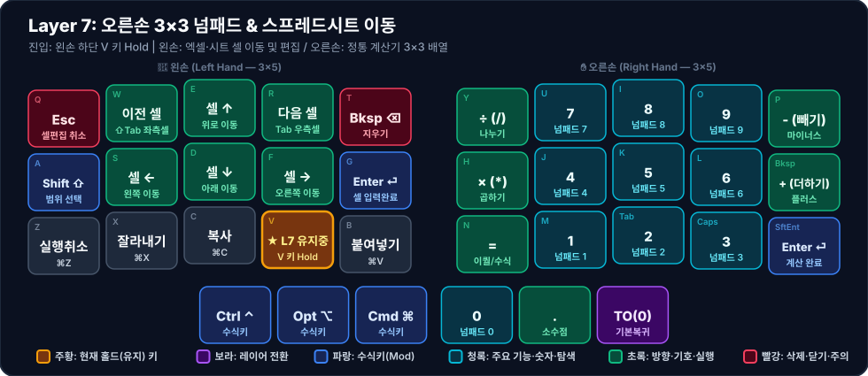

# 🔢 Layer 7: 오른손 3×3 넘패드 (Numpad)

**진입 방법**: 왼손 하단 네 번째 키 `V` (`LT(7, KC_V)`, Index `13`) 홀드

한두 글자의 숫자는 [[layer-1-nav-num-sym|Layer 1]] 상단 열로 입력하고, **전화번호·금액·통계 데이터·엑셀 수식 등 연속된 숫자 입력**이 필요할 때는 왼손 검지로 `V`를 누른 채 오른손을 정통 3×3 계산기 배열로 사용합니다.

---

## 1. 시각적 키맵 다이어그램 (Visual Keymap)

### 🤚 왼손 키 배치표 (Left Hand — 1칸 = 1키)

| 행 \ 손가락 | 새끼 (`Col 0`) | 약지 (`Col 1`) | 중지 (`Col 2`) | 검지 (`Col 3`) | 안쪽 검지 (`Col 4`) |
| :---: | :---: | :---: | :---: | :---: | :---: |
| **상단 (`Q~T`)** | **Esc** <small>`셀편집 취소`</small> | **이전 셀** <small>`⇧Tab 좌측셀`</small> | **셀 ↑** <small>`위로 이동`</small> | **다음 셀** <small>`Tab 우측셀`</small> | **Bksp ⌫** <small>`지우기`</small> |
| **중단 (`A~G`)** | **Shift ⇧** <small>`범위 선택`</small> | **셀 ←** <small>`왼쪽 이동`</small> | **셀 ↓** <small>`아래 이동`</small> | **셀 →** <small>`오른쪽 이동`</small> | **Enter ⏎** <small>`셀 입력완료`</small> |
| **하단 (`Z~B`)** | **실행취소** <small>`⌘Z`</small> | **잘라내기** <small>`⌘X`</small> | **복사** <small>`⌘C`</small> | 🟧 **★ L7 유지중** <small>V 키 Hold</small> | **붙여넣기** <small>`⌘V`</small> |
| **엄지 (3키)** | *(없음)* | *(없음)* | **Ctrl ⌃** <small>`수식키`</small> | **Opt ⌥** <small>`수식키`</small> | **Cmd ⌘** <small>`수식키`</small> |

### ✋ 오른손 키 배치표 (Right Hand — 1칸 = 1키)

| 행 \ 손가락 | 안쪽 검지 (`Col 4`) | 검지 (`Col 3`) | 중지 (`Col 2`) | 약지 (`Col 1`) | 새끼 (`Col 0`) |
| :---: | :---: | :---: | :---: | :---: | :---: |
| **상단 (`Y~P`)** | **÷ (/)** <small>`나누기`</small> | **7** <small>`넘패드 7`</small> | **8** <small>`넘패드 8`</small> | **9** <small>`넘패드 9`</small> | **- (빼기)** <small>`마이너스`</small> |
| **중단 (`H~⌫`)** | **× (*)** <small>`곱하기`</small> | **4** <small>`넘패드 4`</small> | **5** <small>`넘패드 5`</small> | **6** <small>`넘패드 6`</small> | **+ (더하기)** <small>`플러스`</small> |
| **하단 (`N~⏎`)** | **=** <small>`이퀄/수식`</small> | **1** <small>`넘패드 1`</small> | **2** <small>`넘패드 2`</small> | **3** <small>`넘패드 3`</small> | **Enter ⏎** <small>`계산 완료`</small> |
| **엄지 (3키)** | **0** <small>`넘패드 0`</small> | **.** <small>`소수점`</small> | **TO(0)** <small>`기본복귀`</small> | *(없음)* | *(없음)* |

---

## 2. 주요 설계 특징

1. **오른손 중앙 3×3 숫자 + 좌우 사칙연산 배치**
   - 오른손 검지·중지·약지(`U,I,O` / `J,K,L` / `M,Tab,Caps` 자리)에 `7-8-9`, `4-5-6`, `1-2-3`을 배치했습니다.
   - 안쪽 열(`Y, H, N` 자리)에 `/`, `*`, `=`를, 바깥쪽 열(`P, Bksp, SftEnt` 자리)에 `-`, `+`, `Enter`를 배치하고, 엄지에 `0`과 `.`(소수점)을 두어 오른손 하나로 모든 수식 계산이 끝납니다.
2. **왼손 스프레드시트(Excel / Google Sheets) 내비게이션**
   - `W, E, R` 자리와 `S, D, F` 자리에 `↑ / ← ↓ →`(역T자 방향키)와 좌우 셀 이동(`⇧Tab`, `Tab`), 줄바꿈(`Enter`), 오타 수정(`Bksp`)을 배치해 시트 데이터 입력 효율을 극대화했습니다.
