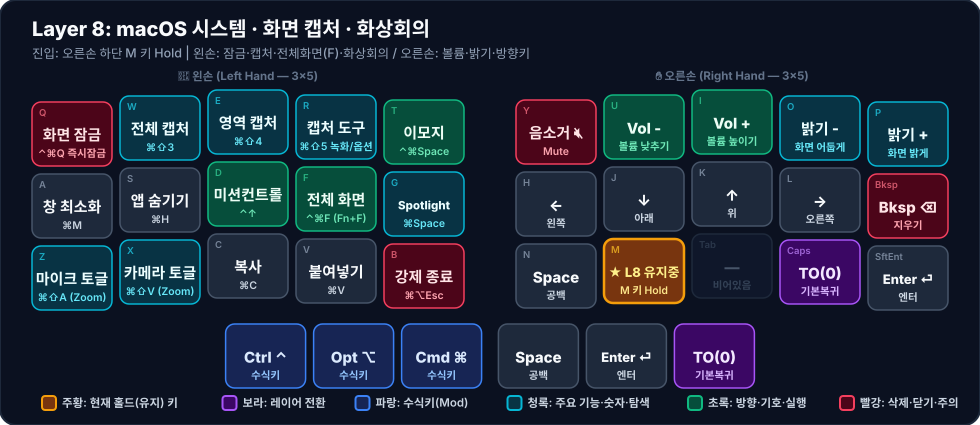

# 🖥️ Layer 8: macOS 시스템 · 캡처 · 화상회의

**진입 방법**: 왼손 하단 안쪽 검지 키 `B` (`LT(8, KC_B)`, Index `14`) 홀드

왼손 검지로 `B`를 누른 상태에서 왼손으로 화면 캡처, 화면 잠금, 이모지 입력기, 화상회의 토글을 실행하고, 오른손으로는 밝기·볼륨·방향키를 조작하는 시스템 제어 레이어입니다. (왼손 하단 `Z, X, C, V, B` 5개 키가 차례로 Layer 4, 5, 6, 7, 8에 일렬로 대응되어 직관적으로 조작할 수 있습니다.)

---

## 1. 시각적 키맵 다이어그램 (Visual Keymap)

### 🤚 왼손 키 배치표 (Left Hand — 1칸 = 1키)

| 행 \ 손가락 | 새끼 (`Col 0`) | 약지 (`Col 1`) | 중지 (`Col 2`) | 검지 (`Col 3`) | 안쪽 검지 (`Col 4`) |
| :---: | :---: | :---: | :---: | :---: | :---: |
| **상단 (`Q~T`)** | **화면 잠금** <small>`⌃⌘Q 즉시잠금`</small> | **전체 캡처** <small>`⌘⇧3`</small> | **영역 캡처** <small>`⌘⇧4`</small> | **캡처 도구** <small>`⌘⇧5 녹화/옵션`</small> | **이모지** <small>`⌃⌘Space`</small> |
| **중단 (`A~G`)** | **창 최소화** <small>`⌘M`</small> | **앱 숨기기** <small>`⌘H`</small> | **미션컨트롤** <small>`⌃↑`</small> | **전체화면** <small>`⌃⌘F (Fn+F)`</small> | **Spotlight** <small>`⌘Space`</small> |
| **하단 (`Z~B`)** | **마이크 토글** <small>`⌘⇧A (Zoom)`</small> | **카메라 토글** <small>`⌘⇧V (Zoom)`</small> | **복사** <small>`⌘C`</small> | **붙여넣기** <small>`⌘V`</small> | **강제 종료** <small>`⌘⌥Esc`</small> |
| **엄지 (3키)** | *(없음)* | *(없음)* | **Ctrl ⌃** <small>`수식키`</small> | **Opt ⌥** <small>`수식키`</small> | **Cmd ⌘** <small>`수식키`</small> |

### ✋ 오른손 키 배치표 (Right Hand — 1칸 = 1키)

| 행 \ 손가락 | 안쪽 검지 (`Col 4`) | 검지 (`Col 3`) | 중지 (`Col 2`) | 약지 (`Col 1`) | 새끼 (`Col 0`) |
| :---: | :---: | :---: | :---: | :---: | :---: |
| **상단 (`Y~P`)** | **음소거 🔇** <small>`Mute`</small> | **Vol -** <small>`볼륨 낮추기`</small> | **Vol +** <small>`볼륨 높이기`</small> | **밝기 -** <small>`화면 어둡게`</small> | **밝기 +** <small>`화면 밝게`</small> |
| **중단 (`H~⌫`)** | **←** <small>`왼쪽`</small> | **↓** <small>`아래`</small> | **↑** <small>`위`</small> | **→** <small>`오른쪽`</small> | **Bksp ⌫** <small>`지우기`</small> |
| **하단 (`N~⏎`)** | **Space** <small>`공백`</small> | 🟧 **★ L8 유지중** <small>M 키 Hold</small> | <small>*(비어있음)*</small> | **TO(0)** <small>`기본복귀`</small> | **Enter ⏎** <small>`엔터`</small> |
| **엄지 (3키)** | **Space** <small>`공백`</small> | **Enter ⏎** <small>`엔터`</small> | **TO(0)** <small>`기본복귀`</small> | *(없음)* | *(없음)* |

---

## 2. 주요 설계 특징

1. **왼손 상단 캡처 & 보안 클러스터 (`Q, W, E, R, T` 자리)**
   - 자리를 비울 때 `M + Q`(`⌃⌘Q`)로 즉시 화면을 잠그고, 캡처가 필요할 때 `M + W/E/R`(`⌘⇧3 / 4 / 5`)로 손가락 꺾임 없이 스크린샷을 찍습니다.
2. **왼손 하단 화상회의 단축키 (`Z, X` 자리)**
   - Zoom 등의 화상회의 표준 단축키인 `⌘⇧A`(마이크 음소거 토글)와 `⌘⇧V`(비디오 토글)를 배치했습니다.
3. **오른손 상단 미디어 & 디스플레이 밝기 제어**
   - [[layer-3-mouse-media|Layer 3]]에 없는 macOS 디스플레이 밝기 조절(`KC_BRID`, `KC_BRIU`)을 볼륨 키 옆에 나란히 배치했습니다.
