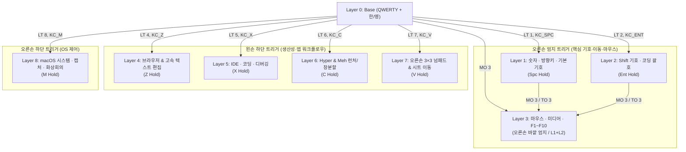

# 🗺️ X.Tips X7 (36키) 키맵 아키텍처 총괄

이 문서는 **X.Tips X7 (36키 스플릿 키보드)**를 활용한 macOS 중심 키맵 및 워크플로우의 핵심 설계 철학과 9개 레이어(`Layer 0` ~ `Layer 8`)의 유기적 연결 구조를 다룹니다.

- **적용 대상 하드웨어**: [[hardware-matrix-x7|X.Tips X7 (3×5 + 3 Thumb Split)]] ([via-x7.json](file:///Users/yong/Documents/UseVia/via-x7.json))
- **현재 활성 레이아웃**: [x_tips_x7_keyboard.layout.json](file:///Users/yong/Documents/UseVia/x_tips_x7_keyboard.layout.json)
- **통합 치트시트**: [x7_keymap_manual.md](file:///Users/yong/Documents/UseVia/x7_keymap_manual.md)

---

## 1. 4대 핵심 설계 철학

1. **Momentary Hold 중심 (0초 복귀)**
   - 모든 보조 레이어(`Layer 1` ~ `Layer 8`)는 기본적으로 **누르고 있는 동안만 활성화(`MO` / `LT`)**되며, 손을 떼는 즉시 기본 레이어([[layer-0-base|Layer 0]])로 복귀합니다.
   - 예외적으로 마우스 조작([[layer-3-mouse-media|Layer 3]])만 장시간 한 손 사용을 위해 `TO(3)` 고정 진입 및 `TO(0)` 해제 경로를 함께 제공합니다.
2. **홈 로우 오타 방지 (Bottom-Row + Thumb Layer-Tap)**
   - 빠른 한/영 타이핑 시 롤오버(Rollover) 오작동을 유발하기 쉬운 Home Row Mods(`A/S/D/F` 홀드) 대신, **오른손 엄지 3키(`L1`, `L2`, `L3`)**와 **하단 알파벳 열(`Z=L4`, `X=L5`, `C=L6`, `V=L7`, `M=L8`)**에 레이어 트리거를 배치했습니다. (상세: [[layer-trigger-strategy|레이어 트리거 전략]])
3. **왼손 고정 수식키 데크 (Dedicated Left Thumb Modifiers)**
   - 왼손 엄지 3키(`Ctrl`, `Opt`, `Cmd`)는 **전 레이어(L0~L8)에서 동일한 위치에 고정**되어 있습니다.
   - 덕분에 오른손 엄지로 [[layer-1-nav-num-sym|Layer 1]](방향키/숫자)을 열면서 왼손 엄지로 `Cmd`나 `Opt`를 조합(`Cmd+←/→`, `Opt+←/→`, `Cmd+1~9`)하는 동작이 직관적으로 이루어집니다.
4. **1:1 기호 매칭 (Layer 1 ↔ Layer 2 대칭)**
   - [[layer-1-nav-num-sym|Layer 1]]의 숫자·기본 기호 위치와 [[layer-2-shift-sym|Layer 2]]의 Shift 기호 위치가 1:1로 대응되어 암기 부담을 절반으로 줄였습니다. (상세: [[coding-and-ide|코딩 및 IDE 워크플로우]])

---

## 2. 9개 레이어 역할 및 진입 지도

| 레이어 | 문서 링크 | 진입 트리거 | 짧은 탭(Tap) | 핵심 용도 |
| :---: | :--- | :--- | :---: | :--- |
| **L0** | [[layer-0-base\|Layer 0: Base]] | 기본 상태 (`TO(0)`) | - | QWERTY 타이핑, `Caps(한/영)`, `SftEnt`, 왼손 엄지 `⌃⌥⌘` |
| **L1** | [[layer-1-nav-num-sym\|Layer 1: Nav/Num/Sym]] | 오른손 안쪽 엄지 홀드 | `Space` | 상단 `1~0`, 오른손 기본 기호(`[];'\,./`), 왼손 방향키(`←↓↑→`) |
| **L2** | [[layer-2-shift-sym\|Layer 2: Shift Sym]] | 오른손 중간 엄지 홀드 | `Enter` | 상단 `!~)`, 오른손 중괄호·연산자(`{}:"<>?`), `Home/PgDn/PgUp/End` |
| **L3** | [[layer-3-mouse-media\|Layer 3: Mouse/Media]] | 오른손 바깥 엄지 홀드 (또는 L1+L2) | - | 오른손 마우스 커서·휠·클릭·미디어, 왼손 `F1~F10` 및 미션컨트롤 |
| **L4** | [[layer-4-browser-edit\|Layer 4: Browser/Edit]] | 왼손 하단 `Z` 홀드 | `z` | 왼손 브라우저 탭 제어(`⌘W/T/R/L`), 오른손 단어·줄 단위 커서 이동 |
| **L5** | [[layer-5-ide-coding\|Layer 5: IDE/Coding]] | 왼손 하단 `X` 홀드 | `x` | VS Code 명령 팔레트(`⌘⇧P`), 심볼/정의 이동(`F12`), 줄 이동·주석·디버그 |
| **L6** | [[layer-6-hyper-meh\|Layer 6: Rectangle/Hyper]] | 왼손 하단 `C` 홀드 | `c` | Rectangle 무설정 창 분할(2/3/4분할·최대화·모니터이동) + 왼손 `Hyper` 8키 |
| **L7** | [[layer-7-numpad\|Layer 7: Numpad]] | 왼손 하단 `V` 홀드 | `v` | 오른손 3×3 정통 계산기 배열 + 사칙연산, 왼손 엑셀/시트 셀 이동 |
| **L8** | [[layer-8-macos-system\|Layer 8: macOS System]] | 오른손 하단 `M` 홀드 | `m` | 화면 잠금(`⌃⌘Q`), 캡처(`⌘⇧3/4/5`), Zoom 마이크/카메라 토글, 밝기/볼륨 |

---

## 3. 도메인별 워크플로우 연결

- **코딩 & IDE 작업**: [[coding-and-ide|코딩 및 IDE 워크플로우]] ([[layer-1-nav-num-sym|L1]] + [[layer-2-shift-sym|L2]] + [[layer-5-ide-coding|L5]])
- **브라우징 & 텍스트 편집**: [[browsing-and-text-editing|브라우징 및 고속 편집 워크플로우]] ([[layer-4-browser-edit|L4]] + [[layer-1-nav-num-sym|L1]])
- **macOS 창 관리 & 런처 & 시스템 제어**: [[macos-window-and-raycast|macOS 창 관리 및 Raycast 워크플로우]] ([[layer-3-mouse-media|L3]] + [[layer-6-hyper-meh|L6]] + [[layer-8-macos-system|L8]])
